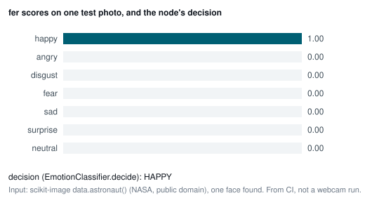

# Facial Emotion Detector

Real-time facial emotion detection with ROS 2 Humble, OpenCV and the `fer` library (a
pre-trained FER2013 CNN behind a Haar face detector). Maps the seven FER scores to five classes
(happy, sad, angry, surprised, neutral), smooths over 5 frames and publishes `/facial_emotion`.

**Accuracy, honestly:** FER2013 is a hard 48x48 grayscale dataset; the best published models
reach about 73 % on it and the `fer` package model sits around 65 %. On a webcam the useful
classes are HAPPY, SURPRISED and NEUTRAL; SAD and ANGRY are under-reported, so the decision
thresholds in `EmotionClassifier.decide()` are deliberately biased toward them (see the
constants at the top of the class). Expect confident smiles and open-mouth surprise to be right,
and sad/angry to flip with lighting and head pose. It is a demo of the ROS 2 pipeline, not a
calibrated classifier.

## Quick start

Requires Ubuntu 22.04, ROS 2 Humble, a webcam, and `sudo apt install ros-humble-cv-bridge ros-humble-image-transport python3-opencv`. No screenshot here: it needs a live camera.

```bash
mkdir -p ~/facial_emotion_ws/src
git clone <this repo URL> ~/facial_emotion_ws/src/facial_emotion_detector
cd ~/facial_emotion_ws && source /opt/ros/humble/setup.bash
colcon build --packages-select facial_emotion_detector
```

`fer` pulls in TensorFlow (about 600 MB), so it goes in a venv that still sees the apt `rclpy` (`--no-deps` skips `facenet-pytorch` and its CUDA torch download, unused here):

```bash
python3 -m venv --without-pip --system-site-packages ~/.venv-fer
~/.venv-fer/bin/python3 -m pip install --no-deps fer
~/.venv-fer/bin/python3 -m pip install tensorflow-cpu requests pillow
~/.venv-fer/bin/python3 -c "from fer.fer import FER; import numpy as np; print(FER(mtcnn=False).detect_emotions(np.zeros((480,640,3),np.uint8)))"
```
The last line must print `[]` (model loaded, no face in a black frame). Verified with fer 25.10.3

The venv uses the apt OpenCV (4.5 on Ubuntu 22.04). If you install OpenCV with pip instead, keep it below 5 (`"opencv-python-headless<5"`): OpenCV 5 has no `cv2.CascadeClassifier`, which `fer`'s face detector uses (CI run 1012217 failed with `module 'cv2' has no attribute 'CascadeClassifier'`; green with `<5`).



CI job `real-model` runs this install and the repo's `EmotionClassifier` on scikit-image's `astronaut()` photo (NASA, public domain): one face, `happy` 1.00, decision HAPPY (`scripts/real_model_demo.py`, run 69bd29c).
and tensorflow-cpu 2.21 on Python 3.10.

Run (`ros2 run` would use the system Python, so start it with the venv's):

```bash
source ~/facial_emotion_ws/install/setup.bash
~/.venv-fer/bin/python3 -m facial_emotion_detector.emotion_detector_node --ros-args -p camera_id:=0
# a window shows the face box, label, emoji and FPS; Q quits
```

## How to test

1. **Logic, no hardware** (runs in CI):
   ```bash
   python3 -m pytest test/test_emotion_classifier.py
   ```
2. **Model + camera, one frame** (prints the raw FER scores so you can judge the thresholds):
   ```bash
   ~/.venv-fer/bin/python3 - <<'PY'
   import cv2
   from fer.fer import FER
   cap = cv2.VideoCapture(0); ok, frame = cap.read(); cap.release()
   assert ok, "camera 0 gave no frame"
   for face in FER(mtcnn=False).detect_emotions(frame):
       print(face["box"], {k: round(v, 2) for k, v in face["emotions"].items()})
   PY
   ```
   No output = no face found (light your face, look at the camera).
3. **ROS 2 pipeline**: start the node, then in another terminal
   ```bash
   ros2 topic echo /facial_emotion
   ```
   and act out the guide in [docs/USAGE.md](docs/USAGE.md). Pass = HAPPY and SURPRISED switch within a second; NEUTRAL at
   rest. SAD/ANGRY are best-effort.

Not measured: frame rate and end-to-end latency (no script records them).

More: the emotion guide, node and topic layout, the decision thresholds and troubleshooting in [docs/USAGE.md](docs/USAGE.md).

## License

MIT, see LICENSE.
